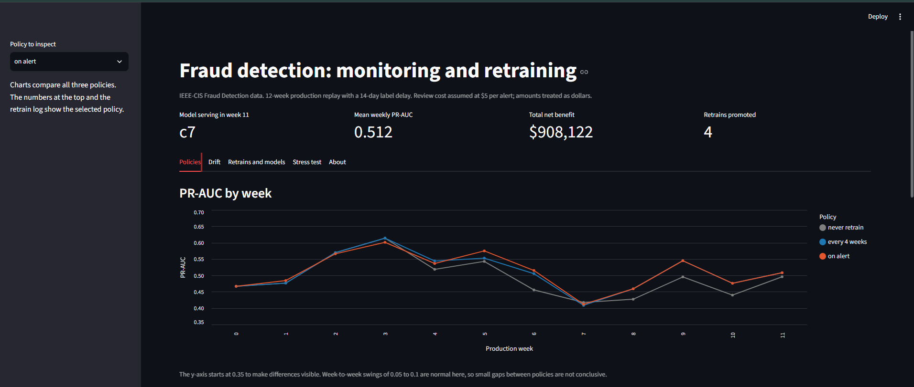
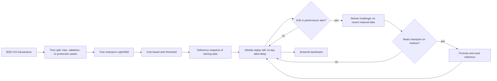

# Fraud detection with drift monitoring and automatic retraining

A fraud model that is watched after it ships. It is trained on the past, replayed on 12 weeks of "future" transactions with realistic label delays, monitored for drift, and retrained when needed. A dashboard shows what happened.

**Live dashboard:** [https://fraud-monitoring-mpzmmdvdzsbowe3m3jqedy.streamlit.app/](https://fraud-monitoring-mpzmmdvdzsbowe3m3jqedy.streamlit.app/)

Built by [Samarpita CHowdhury] · [https://www.linkedin.com/in/samarpitachowdhury/] · [https://github.com/Samarpita1612]



## The problem

Most fraud projects stop at "99% accuracy". In production, fraud is rare (about 3.5% here), fraudsters change tactics, and fraud labels arrive weeks late. A model that looked good on test data can quietly get worse. This project asks:

1. How good is a fraud model on a realistic time-based test, scored with metrics that suit rare events?
2. What happens to it over the next 12 weeks if nobody touches it?
3. Can monitoring and retraining help, and what does it cost and gain?

## What I built



- **Time-based split, no leakage.** Train on days 0-60, tune on days 60-90, replay days 90-174 as 12 weekly batches. Features use only the current row and the past, checked with a "cut off the future" test.
- **Cost-based threshold.** The alert threshold maximises *net benefit = fraud dollars caught minus review cost times alerts*, not accuracy.
- **Monitoring.** PSI and KS drift checks against a reference snapshot, plus a performance check that only uses labels at least 14 days old.
- **Champion-challenger retraining.** A challenger trains on the 60 days before a 14-day holdout of the newest matured data. It is promoted only if it is at least 2% better on holdout PR-AUC and at least as good on net benefit.
- **Policy comparison.** Never retrain, retrain every 4 weeks, and retrain on alert, all replayed on the same 12 weeks.
- **Stress test.** Injected faults to see which alarms fire.

## Data

IEEE-CIS Fraud Detection (Kaggle), `train_transaction.csv`: 590,540 transactions, 3.5% fraud, about 6 months. The data is not included in this repo (see the Kaggle competition rules). I used the 52 non-anonymised columns and skipped the 339 anonymised `V` columns in version 1.

| Period | Days | Rows | Fraud rate |
|---|---|---|---|
| Train | 0-60 | 220,806 | 3.1% |
| Validation | 60-90 | 91,768 | 4.0% |
| Production replay | 90-174 | 254,694 | 3.6% |

## Results

### 1. Model quality on validation (days 60-90)

| Model | PR-AUC | ROC-AUC | Recall at 80% precision |
|---|---|---|---|
| Random guess | 0.0408 | 0.5051 | 0.0000 |
| Logistic regression | 0.2140 | 0.7977 | 0.0208 |
| LightGBM, 62 features (with 10 engineered) | 0.6160 | 0.9175 | 0.4216 |
| **LightGBM, 52 raw features (champion v1)** | **0.6295** | 0.9181 | 0.4670 |

PR-AUC is the main metric because accuracy is meaningless at 3.5% fraud. My 10 engineered features (velocity, amount ratios and similar) did **not** improve the model in a single-seed comparison, so the champion uses the raw columns. Validation scores are slightly optimistic because I stopped training and tuned the threshold on those rows.

### 2. Cost-based threshold (champion, validation)

| Assumed review cost | Threshold | Alert rate | Precision | Recall | Net benefit (30 days) |
|---|---|---|---|---|---|
| $1 | 0.0040 | 60.5% | 6.5% | 96.9% | $449,614 |
| **$5 (used)** | **0.0173** | **19.2%** | **17.8%** | **84.7%** | **$347,044** |
| $25 | 0.0761 | 5.5% | 47.1% | 64.7% | $176,813 |
| $50 | 0.1714 | 3.2% | 68.4% | 54.2% | $89,717 |

The review cost is my assumption, not data. The threshold is sensitive to it, which is why the table is here. At $5 the rule flags about one payment in five, which a real review team could not handle, so a real deployment would need a capacity limit.

### 3. Twelve weeks in production

The champion v1, never retrained, averaged **PR-AUC 0.49** over the 12 production weeks (range 0.42 to 0.61), against 0.63 on validation. It was already falling in the weeks right after training: 0.730, 0.656, 0.607, 0.544 in the four validation weeks, then 0.467 in production week 0.

| Policy | Retrains | Mean weekly PR-AUC | Total net benefit | vs never retrain |
|---|---|---|---|---|
| Never retrain | 0 | 0.493 | $866,880 | |
| Retrain every 4 weeks | 2 | 0.510 | $919,708 | +$52.8K (+6.1%) |
| Retrain on alert | 4 | 0.512 | $908,122 | +$41.2K (+4.8%) |

What I take from it:

- Retraining helped modestly and did not restore validation-level performance.
- Alert-triggered retraining did **not** beat the scheduled policy. All four alerts were feature-drift alerts.
- **One model carries most of the gain.** Model c7, which served weeks 8-11 in both retraining policies, raised net benefit by about 20% over those weeks. Weeks 8-11 account for 69% (every 4 weeks) and 89% (on alert) of each policy's total gain. Earlier retrains were close to break-even, and c0 lost about $6,400 in its two live weeks even though it passed the holdout check.
- Differences between the two retraining policies are well inside normal week-to-week variation (weekly PR-AUC moves by 0.05 to 0.1).

### 4. What drifted

- **Product W (80% of rows, about 46% of production fraud)** is where performance fell: PR-AUC 0.313 on validation to 0.131 in production, with a flat 2.1% fraud rate. Product C fell only from 0.854 to 0.768.
- The anonymised `M` columns exist only for product W, and the share of blanks within W fell from 70% (train) to 54% (validation) to 25% (production). `D11` and `M1` changed alongside. This fits the decline in W but I have not shown that it causes it.
- PSI against the original training window was 0.58 to 0.91 for the M group and 0.33 to 0.77 for the D group in every production week. After each retrain the reference resets and the PSI falls, reaching 0.04 to 0.16 for these groups by weeks 8-11 with the last model serving.
- Retraining mostly helped product W (pooled PR-AUC over weeks 4-11: 0.117 to 0.18-0.19) and left products C and R unchanged within 0.01.

### 5. Stress test of the alert rules

Alert rules (v2): score PSI above 0.25; at least 2 of 6 feature groups with PSI above 0.25; pooled PR-AUC of the last 2 matured weeks more than 20% below the model's holdout score at deployment. Tested on weeks 8-11 with model c7 serving, rules frozen.

| Scenario | Injected fault | Alert weeks | What fired |
|---|---|---|---|
| Clean | none | 11 | Performance drop (0.505 vs line 0.508) |
| Amount x1.5 | all prices 50% higher | 11 | Performance drop only (0.493). Drift rules stayed silent because only one feature group moved (PSI 0.51-0.57) |
| Feed outage | all M and D columns blank | 8, 9, 10, 11 | Score drift and feature drift from the first week (score PSI 0.52-0.68) |
| Concept shift | half of the fraud labels replaced by random draws | 11 | Performance drop (pooled PR-AUC 0.163), three weeks after onset |

Takeaways: label-free checks catch broken feeds immediately. Silent changes in how fraud behaves are only visible through delayed labels. The performance rule fired on clean data, so by itself it is not specific.

## Limitations (please read)

- **One run, one seed, 12 weeks.** Weekly PR-AUC varies by 0.05 to 0.1, so small differences are not conclusive.
- **The alert rules were designed after I had seen the production weeks**, so the policy comparison is a development result, not a clean out-of-sample test. The stress test is the only part run on rules frozen beforehand, and it has few decisions (the performance rule decides once per scenario).
- **The performance rule rarely had a chance to fire** in the policy comparison, because it needs two matured weeks of the current model and the 14-day label delay makes that slow.
- **The promotion guard never rejected a challenger**, so I cannot claim it prevents bad swaps. It approved c0, which then lost money.
- **The performance rule is not specific.** Its baseline (a holdout next to the training window) is higher than live performance, so it fired on untouched data.
- **Drift rules count feature groups**, so a big change in a single group (such as prices) does not raise an alert.
- **Money figures rest on assumptions:** $5 review cost, amounts treated as dollars, and a caught fraud saving its full amount. Part of the money gain may come from each retrained model choosing its own threshold.
- **Retraining gain is concentrated** in one product (W) and one model (c7).
- The pseudo customer ID (`card1`, `card2`, `addr1`) is an approximation. PSI has no upper limit (a fully blank feed gave about 14).
- Categories are fixed from the original training window; unseen categories become blanks.

## Run it yourself

Developed on Python 3.14. The dashboard alone runs on Python 3.12 or 3.13.

```bash
pip install -r requirements-full.txt      # full environment for the notebooks
# download train_transaction.csv from the Kaggle IEEE-CIS competition into data/raw/
# then run notebooks/01 to 07 in order
streamlit run app/dashboard.py
```

The dashboard only needs the small files in `docs/` and `models/registry.json`, which are in this repo, so it runs without the raw data.

## Repo layout

```
app/dashboard.py          Streamlit dashboard
src/                      features, metrics, threshold, reference, drift, monitor, retrain, simulate
notebooks/                01 EDA and split, 02 features, 03 baselines, 04 champion,
                          05 monitoring, 06 policies, 07 stress test
docs/decisions.md         every design decision and assumption, in order
docs/*.csv                logs read by the dashboard
models/                   saved models and registry.json
```
